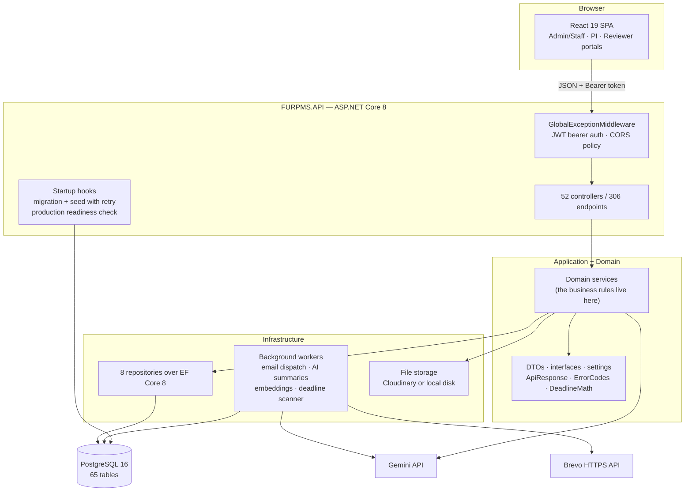

# FURPMS — Research Project Management System

**A regulation-driven platform that runs the whole lifecycle of a university research project — proposal → council review → contract → disbursement → progress reporting → acceptance → settlement — replacing the Word/Excel/paper chain it was modelled on.**

Built as the capstone project **SU26SE053** at FPT University, against the university's own regulation *QĐ 543/QĐ-ĐHFPT* on managing scientific research projects.


| | |
|---|---|
| **Backend** | ASP.NET Core 8 Web API · 52 controllers · **306 endpoints** |
| **Data** | PostgreSQL 16 + EF Core 8 · **65 entities** · 8 migrations |
| **Tests** | **417 xUnit test cases** in 70 files, EF Core InMemory, GitHub Actions on every push/PR |
| **Business rules** | **104 rules** catalogued and traced from regulation article → enforcing method → error code |
| **Frontend** | React 19 + TypeScript SPA, 3 portals (Admin/Staff · PI · Reviewer) — [separate repo](https://github.com/immanhdung/FURPMS-Web/tree/dev) |
| **Outputs** | Word/Excel documents matching the regulation's official forms (BM04, BM10, BM11, BM12, BM13) |

---

## Table of contents

- [The problem](#the-problem)
- [Who uses it](#who-uses-it)
- [Project lifecycle](#project-lifecycle)
- [Feature highlights](#feature-highlights)
- [Architecture](#architecture)
- [Data model](#data-model)
- [Tech stack](#tech-stack)
- [Engineering notes: problems worth reading about](#engineering-notes-problems-worth-reading-about)
- [Testing](#testing)
- [Getting started](#getting-started)
- [Repository layout](#repository-layout)
- [Documentation](#documentation)
- [Frontend](#frontend)
- [Team](#team)
- [Known limitations](#known-limitations)
- [License](#license)

## The problem

A university research project is not a CRUD record. On paper it moves through a cycle where almost every step has a legal constraint:

- **Fixed budget ceilings** per research type (basic ≤ 100M VND, applied ≤ 150M VND), plus **maximum share per expense category** (100/60/60/30/20/10%) — Article 14 and 15 of the regulation.
- **Deadlines that are extended, never overwritten** — the original date has to stay auditable.
- **A review council** whose composition, conflicts of interest, quorum and expertise have to be checked before it can score anything.
- **A verdict that must be explained** when it diverges from the average score, otherwise disbursement gets unlocked for a project that should not have passed.
- **Documents in official formats** that must be produced as Word files, not screenshots.

The team's starting point was a shared drive of Word templates, an Excel budget sheet and a lot of manual copying. FURPMS takes each of those constraints, encodes it as a business rule, gives it an error code, and proves it with a test.

The result is a system where the *interesting* work is not "add a table and a form", but deciding **where** a rule must be enforced so that no endpoint can bypass it.

## Who uses it

| Role | Portal | What they do |
|---|---|---|
| **Administrator** | Admin | Users, roles & permissions, master data (research types, expense categories, rubrics), system settings, audit log |
| **Research Affairs staff** (Phòng QLKH) | Admin/Staff | Opens research cycles, sets deadlines, appoints councils, publishes decisions, manages contracts and disbursement records |
| **Principal investigator** (chủ nhiệm) | PI | Drafts and submits the proposal, manages team & CV, reports progress, uploads evidence, follows the project timeline |
| **Council member** (Chủ tịch / Thư ký / Phản biện / Ủy viên) | Reviewer | Reviews the proposal, scores against the rubric, writes comments, drafts and locks the minutes |

## Project lifecycle

```mermaid
flowchart LR
    A["Staff opens a cycle<br/>1 cycle = 1 research type"] --> B["PI drafts proposal<br/>budget capped on every save"]
    B --> C["Submit<br/>deadline, CV, cap re-checked"]
    C --> D["Council appointed<br/>expertise + conflict-of-interest checks"]
    D --> E["Scoring & minutes<br/>secretary drafts, chair locks"]
    E --> F["Contract + disbursement schedule"]
    F --> G["Progress reports + spending evidence"]
    G --> H["Acceptance<br/>BM11 / BM12"]
    H --> I["Settlement BM13 + archive"]
```



Every decision taken along that path — approval, rejection, revision request, deadline extension, round closure — is appended to a thin `project_decisions` ledger together with the **role the person held at that moment**, so an old record never silently mutates when someone changes job.

## Feature highlights

**Proposals & cycles**
- Wizard-based proposal drafting with optional AI pre-fill from an uploaded `.docx` (manual entry is a first-class path — AI is never mandatory).
- Budget is built from the **six expense categories of Article 15**, each capped as a share of the total; the total is always the sum of the lines, never typed in.
- Versioned proposals (`project_id + version_no + is_current`) with an explicit draft → submitted → withdrawn state machine.

**Council & review**
- Council candidates are ranked so that *selectable* people come first, while conflicted or already-assigned people stay visible with the reason they are blocked.
- Expertise must match at least one of the project's fields; "not yet declared" is reported differently from "wrong field".
- Scoring rounds with a server-side deadline, an overdue flag that **never auto-closes** the round — closure is the chair's decision.
- Minutes editing is role-gated: the secretary drafts, the chair locks. After locking there is no back door; deviations from the score require a written justification.

**Contracts & money**
- Contract record → disbursement schedule generated from a template per research type (four rounds of 30/30/30/10 for applied projects, one 100 % round after acceptance for basic ones) → disbursement batches → evidence upload → settlement.
- Remaining amount is computed from the **contract value**, not the proposal estimate (the estimate is what was asked for; the contract is what was committed).
- Batches are unlocked by conditions, not by dates — the timeline renders "no deadline, blocked by X" instead of inventing a date.

**Deadlines & notifications**
- Deadline extensions are append-only rows; the effective deadline is the latest one and the original is preserved.
- Every countdown (`daysLeft`) is computed **on the server**, because a browser-side subtraction is off by one day near midnight (this actually happened during the demo).
- Notification per event type, delivered by an out-of-band email queue with per-type templates and an audit trail.

**AI assistance (optional, human-in-the-loop)**
- Extract proposal metadata from an uploaded document, summarise reviewer feedback, suggest scores, and flag duplicate proposals via embeddings.
- Nothing is auto-decided: AI output pre-fills a form that a human still submits, and AI verdicts can never reject a proposal — they warn.

**Documents**
- Word/Excel export for the regulation's forms through OpenXML + ClosedXML, with filenames built from the record (BM04, BM10, BM11, BM12, BM13).
- File downloads always go through an authorised endpoint; storage URLs never reach the browser.

**Operations**
- Audit log, decision ledger, email log, system settings, role/permission management, Vietnamese/English UI.

## Architecture



**Four projects, one direction of dependency:** `API → Application → Domain`, with `Infrastructure` plugging implementations into the interfaces declared in `Application`. There is no MediatR pipeline and no AutoMapper: mapping is explicit, because when 104 rules have to be traceable to the line that enforces them, indirection that hides call sites costs more than it saves.

**Conventions that keep 306 endpoints consistent**

- Every response is wrapped in `ApiResponse<T>` with a stable `errorCode` string, so the SPA can branch on a code instead of parsing prose.
- Exceptions map to HTTP semantics in one place: `ArgumentException → 400`, `ForbiddenException → 403`, `KeyNotFoundException → 404`, `InvalidOperationException → 409`. The business-rule catalogue records which code each rule returns.
- All timestamps are UTC end-to-end. A JSON converter coerces incoming `datetime-local` values to UTC before they reach EF Core, because Npgsql rejects `DateTimeKind.Unspecified` on `timestamptz`.
- Anything slow or remote is **queued, not awaited**: email, AI summaries and embeddings run in hosted services, so submitting a proposal never waits for SMTP or an LLM.

**Startup behaviour that exists because production broke**

- Migration + seeding retry for ~30 s, but only on *transient* errors (socket/timeout); a wrong password fails fast instead of retrying ten times.
- Seeding is two-tier: mandatory reference data, then demo data in its own try/catch — demo data must never be able to crash the API.
- `ProductionReadinessCheck` scans configuration at boot and logs loud warnings for the failures that are silent at runtime: email links pointing at localhost, no Cloudinary configured (uploads vanish on redeploy), the sample JWT key still in use.

## Data model

- **65 entities**, snake_case naming enforced by `EFCore.NamingConventions`.
- **Project-centric (v3)**: a `project` is the spine; proposals are versions attached to it, cycles connect to projects through `project_rounds` (many-to-many), and money artefacts (contract, schedule, batches, settlement) hand off from the same root.
- **Append-only where history matters**: `deadline_extensions` (never overwrite a date), `project_decisions` (thin ledger pointing back at the source entity), `email_logs`, `audit_logs`.
- **AI results are cached** in `llm_outputs` keyed by input hash, and embeddings live beside the content hash so unchanged text is never re-embedded.
- 8 EF Core migrations, applied automatically on startup, with an ERD kept as DBML: [`docs/ERD_v3_Project_Centric.dbml`](docs/ERD_v3_Project_Centric.dbml).

## Tech stack

| Layer | Choice | Notes |
|---|---|---|
| Runtime | .NET 8 (`net8.0`), C# with nullable reference types | 4 projects + test project |
| Web | ASP.NET Core controllers, Swashbuckle 6.6.2 | Swagger with bearer auth at `/swagger` |
| Auth | JWT bearer (`Microsoft.AspNetCore.Authentication.JwtBearer` 8.0.11) + BCrypt.Net-Next | Role/permission checks per endpoint |
| Data | EF Core 8.0.11, Npgsql 8, `EFCore.NamingConventions` | Connection string accepts both `Host=…` and `postgresql://…` forms |
| Documents | DocumentFormat.OpenXml 2.16, ClosedXML 0.102 | Word/Excel export of official forms |
| AI | Google Gemini (text + embeddings) over `HttpClient` | No SDK; optional and degradable |
| Email | Brevo HTTPS API (SMTP relay blocked on the host) | Queue + background worker, 10 s send timeout |
| Files | Cloudinary `raw` uploads or local disk | Chosen at startup from configuration |
| Tests | xUnit 2.5.3, EF Core InMemory, coverlet | 417 cases, no database required in CI |
| FE (other repo) | React 19, TypeScript, Vite, Tailwind 4, TanStack Query/Table, react-hook-form + Zod, Zustand, i18next, Radix UI, Recharts | 3 portals, vi/en |
| CI/CD | GitHub Actions (`restore → build Release → dotnet test`) | Pushes to `master`/`dev`/`dev1` and every pull request |
| Deployment | Container (`FURPMS.API/Dockerfile`, multi-stage) + managed PostgreSQL; SPA on Vercel | Published API and SPA are no longer kept online — run locally with the steps below |

## Engineering notes: problems worth reading about

These are the parts I would actually talk through in an interview — each one is a place where the obvious implementation is wrong.

**1. Enforce the budget ceiling where it cannot be bypassed**
A cap check inside "create proposal" is useless: a proposal can be edited, amended, or have its budget rewritten through a different endpoint. `BudgetPolicyService.AssertWithinCapAsync` is called from the proposal sync path, from submit, from the budget-update endpoint and from amendment creation, and the ceiling itself lives in master data (`research_types.max_budget_cap`) — because the regulation allows the rector to approve an exception, and in that case staff raise the cap *with an audit trail* instead of the system hardcoding a number. `AssertCategoryLimitsAsync` collects **every** violating category in one error instead of failing on the first.

**2. A deadline is a fact, not a field**
"Extend deadline" does not update a column. It appends a row to `deadline_extensions`; `DeadlineResolver` is the single place that computes the effective deadline (latest extension wins, original preserved), and every service asks it. Two services computing it independently is how you end up with two different answers on the same screen.

**3. Countdowns belong on the server**
`daysLeft` is computed server-side through `IClock`/`DeadlineMath`. During the second review demo, a browser-side subtraction showed one day less than the server near midnight (browser local time vs UTC) — the fix was to make every DTO that carries a deadline return the number, and forbid the UI from subtracting dates.

**4. Documents are confidential, so the storage URL never leaves the server**
Cloudinary returns a signed URL that is downloadable **without authentication** — the signature is in the URL and does not expire. So the URL exists only server-side; the browser always goes through `/documents/{id}/download`, where the endpoint checks ownership and role, then streams the file. `Document.StorageUrl` stores the *API* download path, never the provider URL, and blob names are GUIDs. When Cloudinary was enabled, `CloudinaryFileStorage` kept a disk fallback so documents uploaded before the switch did not start returning 404.

**5. Email must never block a business action**
`QueuedEmailService` writes to a queue; `EmailDispatchWorker` sends. The SMTP/API send timeout is 10 s, deliberately below the SPA's 15 s request timeout, because a request that outlives the browser's patience looks like a failed submit even when it succeeded. Admins can switch sending off for a demo — the system still records the notification as `SKIPPED`, so the audit trail shows who *would* have been emailed.

**6. AI must be auditable, not magical**
Model output is cached in `llm_outputs` keyed by an input hash (same input never costs a second call), and the duplicate-detection threshold is **0.86** because that is the middle of the measured gap `[0.835 – 0.889]` on a hand-labelled set of 35 pairs — not a number someone liked. The evaluation set is committed (`FURPMS.Tests/Ai/duplicate-eval-set.json`) and asserted in tests. Duplicate detection **warns**; it never rejects a proposal, because a cosine score is not grounds to throw away someone's work.

**7. Startup has to survive a slow database**
Hosted PostgreSQL is reachable a few seconds after the container starts. Calling `Migrate()` on the first line produced `SocketException` → process exit → the platform marked the service "Crashed", which looks like a configuration error. `DatabaseStartup` retries ~30 s but classifies errors: sockets/timeouts retry, credentials/permissions fail fast, because retrying a wrong password just delays the same failure.

**8. Provider-agnostic by accident, and that paid off**
The original target was SQL Server; the deployment target only offered PostgreSQL. The switch was `UseSqlServer → UseNpgsql` plus three T-SQL-specific spots in the DbContext (filtered index, computed column, check constraint quoting) — because there was no raw SQL and no `DateTime.Now` in the codebase; every time read goes through `IClock` and `timestamptz`. EF Core InMemory in tests meant the suite kept running on both providers.

## Testing

```bash
dotnet test        # 417 cases, no database needed
```

- **70 test files / 417 cases**, xUnit with EF Core InMemory — the suite runs in CI on every push and pull request, no container required.
- Tests target rules, not getters: budget cap and category percentages, deadline resolution and extension ordering, quorum and chair-lock behaviour, "the verdict must be justified when it diverges from the score", scoring-window deadlines, duplicate-check threshold evaluation, UTC conversion of `datetime-local` input.
- The test project references `FURPMS.API` on purpose: one rule lives in the JSON layer (UTC coercion), and testing it where it actually runs is more honest than duplicating it in the test project.

## Getting started

**Prerequisites:** .NET 8 SDK, Docker (for PostgreSQL), Node 20+ if you also want the SPA.

```bash
# 1. Database — PostgreSQL 16 on port 5433, so it cannot clash with a local install
docker compose up -d

# 2. API — migrations and reference data are applied automatically at startup
dotnet run --project FURPMS.API
# → Swagger UI: http://localhost:5068/swagger
```

**First login:** the seeder always creates `admin@furpms.edu.vn`. Its password comes from the `SeedAdminPassword` setting; if you do not set one, a random password is generated and **logged once** at startup. Demo accounts and sample projects are seeded **only in the Development environment** — a production database never receives demo credentials.

**Configuration.** `appsettings.json` in this repo carries local-development defaults (the database password matches `docker-compose.yml`, the JWT key is an obvious placeholder) so a fresh clone runs without setup. In any real deployment, override them with environment variables:

| Variable | Purpose | Required |
|---|---|---|
| `ConnectionStrings__DefaultConnection` | PostgreSQL connection (`Host=…` or `postgresql://…`) | yes |
| `JwtSettings__SecretKey` | Token signing key — replace the committed placeholder | yes |
| `SeedAdminPassword` | Initial admin password (random if absent) | recommended |
| `Cors__AllowedOrigins__0` | SPA origin allowed to call the API | production |
| `Cloudinary__CloudName` / `__ApiKey` / `__ApiSecret` | Durable file storage (falls back to local disk) | production |
| `GeminiAI__ApiKey` (+ optional `__Model`, `__EmbeddingModel`) | AI features; they degrade gracefully when absent | optional |
| `EmailSettings__SmtpUsername` / `__SmtpPassword` | Brevo API credentials for transactional email | optional |

## Repository layout

```
FURPMS_BEv2/
├── FURPMS.API/                 # Web host
│   ├── Controllers/            # 52 controllers / 306 endpoints
│   ├── Middleware/             # global exception → ApiResponse
│   ├── Serialization/          # UTC date/time converters
│   ├── Startup/                # migration + seed with retry, readiness checks
│   └── Dockerfile              # multi-stage build, runs on :8080
├── FURPMS.Application/         # DTOs, service interfaces, constants, shared helpers
├── FURPMS.Domain/              # 65 entities — no EF Core dependency
├── FURPMS.Infrastructure/      # DbContext, repositories, services, migrations, seeders
├── FURPMS.Tests/               # 417 xUnit cases
├── docs/                       # engineering documentation (mostly Vietnamese)
├── docker-compose.yml          # PostgreSQL 16 for local development
└── .github/workflows/ci.yml    # restore → build → test on every push and PR
```

## Documentation

The unusual part of this project is that the reasoning is written down. Most documents are in Vietnamese, because that is the language of the regulation and of the review board.

| Document | What it contains |
|---|---|
| [`docs/BUSINESS_RULES.md`](docs/BUSINESS_RULES.md) | **104 rules** across 10 areas, each row stating the rule, its legal basis (article/form), the method that enforces it, and the HTTP error code |
| [`docs/API_CONTRACT.md`](docs/API_CONTRACT.md) | Endpoint-by-endpoint contract used to keep the SPA and API in sync |
| [`docs/ERD_v3_Project_Centric.dbml`](docs/ERD_v3_Project_Centric.dbml) | ERD for the project-centric schema, importable into dbdiagram.io |
| [`docs/QD543_Compliance.md`](docs/QD543_Compliance.md) | Clause-by-clause coverage of the university regulation |
| [`docs/DB_Redesign_v3_PostReview2.md`](docs/DB_Redesign_v3_PostReview2.md) | Why the schema was rebuilt around `project` after the second review |
| [`docs/AI_Duplicate_Detection.md`](docs/AI_Duplicate_Detection.md) | Embedding approach, labelled evaluation set, threshold study |
| [`docs/TEST_CHECKLIST.md`](docs/TEST_CHECKLIST.md) | Manual test checklist by user flow, kept next to the automated suite |
| [`docs/SOFTWARE_PACKAGE_INSTALLATION_GUIDE.md`](docs/SOFTWARE_PACKAGE_INSTALLATION_GUIDE.md) | Install and deployment guide for the package handover |
| [`docs/DEMO_GUIDE.md`](docs/DEMO_GUIDE.md) | The demo flows used in the defence |

## Frontend

The SPA lives in a separate repository: [**immanhdung/FURPMS-Web**](https://github.com/immanhdung/FURPMS-Web/tree/dev) — use the `dev` branch, which is the current code (`main` still holds the first UI prototype).

```bash
git clone -b dev https://github.com/immanhdung/FURPMS-Web.git
cd FURPMS-Web && npm install
npm run dev          # http://localhost:5173  (expects the API on :5068)
```

- React 19 + TypeScript + Vite, TanStack Query for server state, react-hook-form + Zod for forms, Zustand for session/UI state, Tailwind 4 with Radix primitives, Recharts for reporting.
- Three portals from one codebase, with route guards built on the same role/permission model the API enforces — the UI hides what the API would reject, and the API still rejects it.
- Vietnamese/English i18n, `docx-preview` for document previews, and no direct storage URLs anywhere in the client.
- I built the front-end screens for council/review, contracts and disbursement too, but the repository is owned by a teammate, so the front-end architecture is a team credit, not a solo one.

## Team

Capstone **SU26SE053**, FPT University — five members:

| Member | Role |
|---|---|
| **Hoàng Quốc Trung** (SE170589) | Team lead · backend architecture, auth/RBAC, council & contract modules, CI/CD, containerisation, deployment |
| Nguyễn Tấn Phát (SE184672) | Backend · AI module, meetings, proposal domain |
| Nguyễn Lê Hoàng Chinh (SE140506) | Backend · proposals/review, master data, cycles |
| Đàm Mạnh Dũng (SE170580) | Frontend · admin/staff portal |
| Nguyễn Trọng Thứ (SE161992) | Frontend · PI/reviewer portal, database design |

This repository is the backend I led and primarily implemented; the rule catalogue, API contract and test suite were written as part of that work.

## Known limitations

Being explicit about the edges is part of the design:

- **No refresh-token rotation.** Access tokens last 24 h; there is no silent-renew flow, so a session simply ends. Fine for an internal tool, not fine for a public one.
- **No money movement.** The system manages the *money record* (estimate, cap, contract value, schedule, batches, settlement) but never touches cash flow, banking or payments — a deliberate scope decision, documented as a business rule.
- **AI needs an external key.** Without `GeminiAI__ApiKey` the AI endpoints report "not configured"; every AI-assisted step has a manual path.
- **Email depends on a third party** (Brevo over HTTPS, because SMTP egress is blocked on the host). Delivery failures are logged, not retried indefinitely.
- **Single tenant.** One deployment serves one university; there is no organisation-level partitioning.
- **No load or performance testing.** Reporting is aggregate queries over the transactional schema, not a warehouse — adequate for a faculty, not for a whole university system.
- **Manual test checklist is not fully automated.** Some document-export flows are verified by checklist (`docs/TEST_CHECKLIST.md`) rather than by assertions.

## License

Academic capstone project, published for portfolio and recruitment review. The source is **not** licensed for reuse or redistribution; the regulation text and the university's document templates belong to their respective owners. For questions, open an issue or reach me at [github.com/trunghq54](https://github.com/trunghq54).


