# RP4 — Detailed Design diagrams rebuilt from real code

> Mở bằng **VS Code → Ctrl+Shift+V** (Markdown Preview) để xem hình render.
> Nhãn trong hình để **tiếng Anh** vì Report 4 là báo cáo tiếng Anh.
>
> **Quy tắc bắt buộc:** Class Diagram và Sequence Diagram của cùng một khu vực phải sửa
> **thành một cặp**. Cẩm nang có gạch riêng *"Sequence không khớp với kiến trúc class đã mô tả"* —
> sửa một cái mà bỏ cái kia là tạo ra lỗi mới.

## Lớp KHÔNG tồn tại — xoá khỏi mọi hình

Hình cũ vẽ **Unit of Work pattern**. `CLAUDE.md` dòng 7 tuyên bố pattern thật:
`N-tier: Controller → Service → Repository → DbContext`.

| Lớp trong hình cũ | Thực tế (`grep` = 0 file) |
|---|---|
| `BaseAPIController` / `BaseApiController` | ❌ — controller kế thừa thẳng `ControllerBase` |
| `BaseService` | ❌ — service không có lớp cha |
| `IUnitOfWork` / `UnitOfWork` | ❌ |
| `IGenericRepository` / `GenericRepository` | ❌ — tên thật `IRepository<T>` |
| `IMapper` | ❌ — AutoMapper không được cài, mapping làm tay |
| `ITokenService` / `TokenService` | ❌ — tên thật `IJwtService` |
| `IAIService` / `AIService` | ❌ — tên thật `IAiAdvisorService` |
| `IUserContext` / `UserContext` | ❌ |

## Bản đồ 7 khu vực

| Mục RP4 | Class | Sequence |
|---|---|---|
| 3.1 User Authentication & Session Management | Figure 4 | Figure 5 |
| 3.2 Research Cycle & Field Management | Figure 6 | Figure 7 |
| 3.3 Research Proposal Submission | Figure 8 | Figure 9 |
| 3.4 Council Setup & Reviewer Invitation | Figure 10 | Figure 11 (gửi thư mời) + Figure 11b (reviewer trả lời) |
| 3.5 Review Meeting Scheduling | Figure 12 | Figure 13 |
| 3.6 Proposal Evaluation & Scoring | Figure 14 | Figure 15 (chấm phiếu) + Figure 15b (biên bản) |
| 3.7 Research Contract & Report Submission | Figure 16 | Figure 17 (ký HĐ) + Figure 17b (báo cáo tiến độ) |

> **Tổng: 7 class + 9 sequence = 16 hình.** Quy tắc tách một sequence:
> **đổi actor VÀ cách thời gian** — hoặc khi hình vượt ~35 message.

---

## 1.2 — Package Diagram (Figure 2)

Hai bản, chọn một:

- **`docs/report/diagrams/rp4-moi/package-diagram.html`** — 7 hộp, gọn, có legend.
  Xuất SVG/PNG rồi chèn Word. Hợp slide hơn.
- **Mermaid dưới đây** — chi tiết tới cấp thư mục, import vào draw.io sửa được,
  đồng bộ phong cách với 17 hình class/sequence.

```mermaid
flowchart LR
    subgraph WEB["FURPMS-Web"]
        direction TB
        subgraph WEBC["components/"]
            W1[ui]
            W2[layout]
            W3[shared]
            W4[charts]
            W5[tables]
        end
        subgraph WEBF["features/"]
            W6[auth]
            W7[admin]
            W8[staff]
            W9[pi]
            W10[reviewer]
            W11[dashboard]
            W12[analytics]
        end
        subgraph WEBS["services/api/"]
            W13[axiosClient]
            W14["58 service wrappers"]
        end
        subgraph WEBST["store/"]
            W15[auth.store]
            W16[notification.store]
            W17[ui.store]
        end
        W18["i18n · hooks · types"]
    end

    subgraph MOB["FURPMS.Mobile"]
        direction TB
        subgraph MOBA["app/"]
            M1[auth]
            M2[pi]
            M3[reviewer]
        end
        subgraph MOBS["src/"]
            M4[components]
            M5[features]
            M6["services/http"]
            M7["services/secureStore"]
            M8[store]
        end
    end

    subgraph API["FURPMS.API"]
        direction TB
        subgraph APIC["Controllers/ — 51"]
            A1[AuthController]
            A2[ProposalsController]
            A3[CyclesController]
            A4[CouncilsController]
            A5[CouncilMeetingsController]
            A6[ReviewScoringController]
            A7[ContractsController]
            A8[ProgressReportsController]
        end
        A9["Middleware/<br/>GlobalExceptionMiddleware"]
        A10["Startup/<br/>DatabaseStartup · ProductionReadinessCheck"]
        A11["Serialization/<br/>UtcDateTimeConverter"]
        A12["Program.cs"]
    end

    subgraph APP["FURPMS.Application"]
        direction TB
        subgraph APPI["Interfaces/"]
            P1["Services/ — 40 contracts"]
            P2["Repositories/ — IRepository + 9"]
        end
        P3["DTOs/"]
        P4["Common/<br/>ApiResponse · AppException"]
        P5["Constants/<br/>DomainStatus · SystemSettingKeys"]
        P6["Settings/<br/>JwtSettings"]
    end

    subgraph INFRA["FURPMS.Infrastructure"]
        direction TB
        subgraph INFS["Services/ — 58"]
            I1[AuthService]
            I2[ProposalService]
            I3[CycleService]
            I4[CouncilService]
            I5[ReviewScoringService]
            I6[ContractService]
        end
        subgraph INFR["Repositories/"]
            I7["Repository.cs"]
            I8["9 repositories"]
        end
        subgraph INFD["Data/"]
            I9[FURPMSDbContext]
            I10[DatabaseSeeder]
            I11[DemoScenarioSeeder]
        end
        I12["Extensions/<br/>DependencyInjection · PostgresConnectionString"]
        I13["Migrations/"]
    end

    subgraph DOM["FURPMS.Domain"]
        direction TB
        subgraph DOME["Entities/"]
            D1[Users]
            D2[Projects]
            D3[Proposals]
            D4[Review]
            D5[Contracts]
            D6[Progress]
            D7[Cycles]
            D8[Financial]
            D9[MasterData]
            D10[AI]
            D11[Logs]
        end
    end

    subgraph TST["FURPMS.Tests"]
        T1["311 xUnit tests · 43 files"]
    end

    WEB -.->|HTTPS + JWT| API
    MOB -.->|HTTPS + JWT| API
    API -.-> INFRA
    API -.-> APP
    INFRA -.-> APP
    INFRA -.-> DOM
    APP -.-> DOM
    TST -.-> INFRA
    TST -.-> APP
```

> Chiều mũi tên là **phụ thuộc**. `FURPMS.Domain` không có mũi tên đi ra — đúng nguyên tắc
> N-tier, tầng trong cùng không phụ thuộc ai. Đây là câu trả lời sẵn nếu bị hỏi.

---

## 3.1 — User Authentication & Session Management

### Figure 4 — Class Diagram

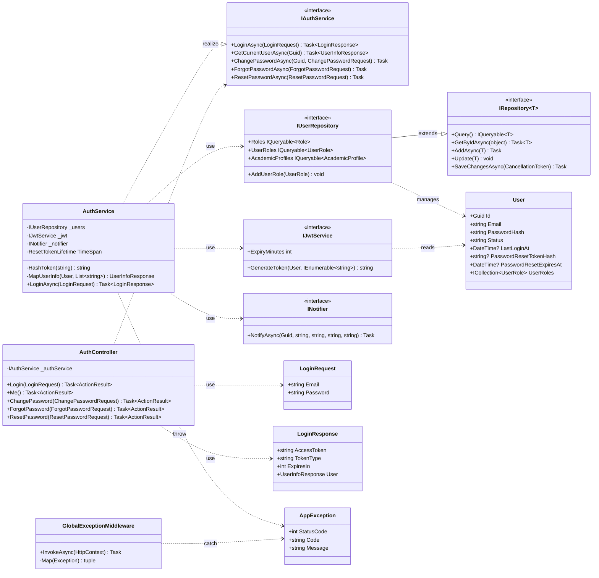

### Figure 5 — Sequence Diagram (login & session initiation)

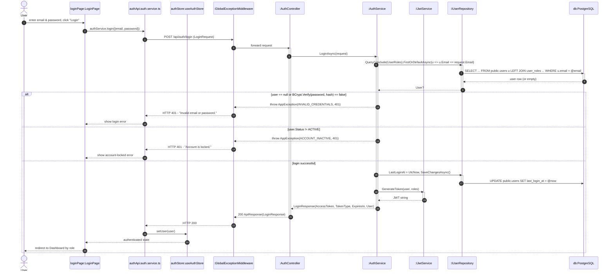

---

## 3.2 — Research Cycle & Field Management

`CycleService` nhận **6 dependency** thật: `ICycleRepository`, `IMasterDataRepository`,
`IProposalRepository`, `IReviewRepository`, `INotifier`, `IDeadlineResolver`.

### Figure 6 — Class Diagram

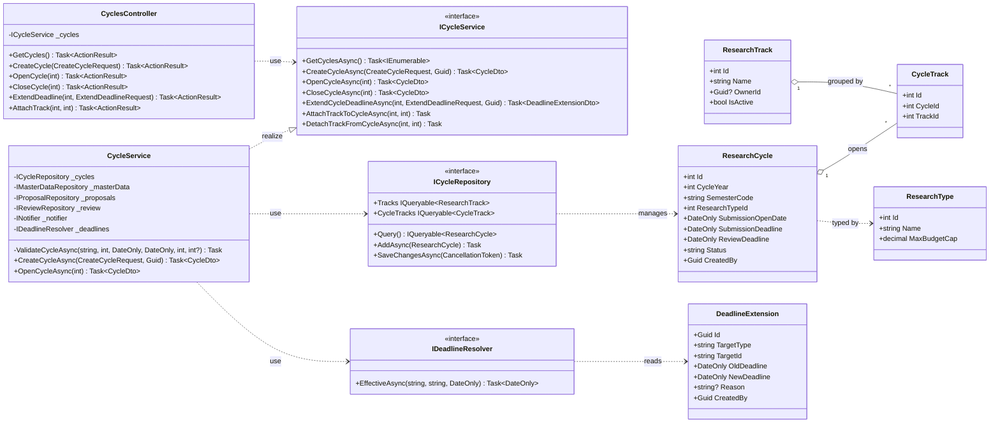

### Figure 7 — Sequence Diagram (create & open a research cycle)

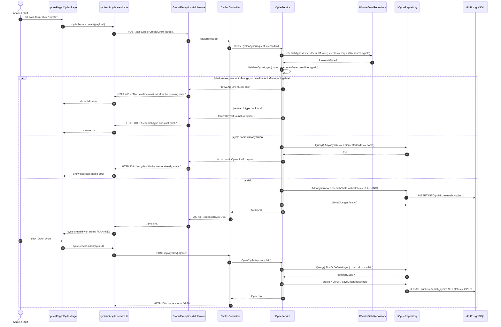

---

## 3.3 — Research Proposal Submission

`ProposalService` là service nặng nhất hệ thống — **13 dependency**. Class diagram liệt kê đủ 13 ở
ngăn thuộc tính, nhưng chỉ vẽ mũi tên tới 5 cái thật sự tham gia luồng nộp, để hình còn đọc được.

### Figure 8 — Class Diagram

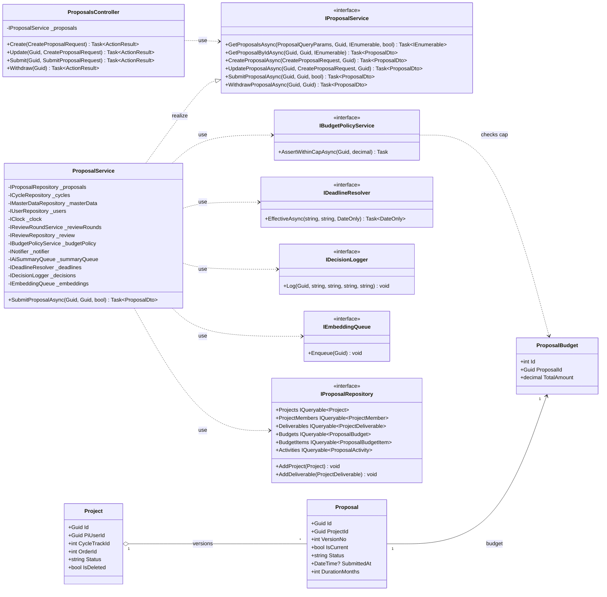

### Figure 9 — Sequence Diagram (submit a proposal)

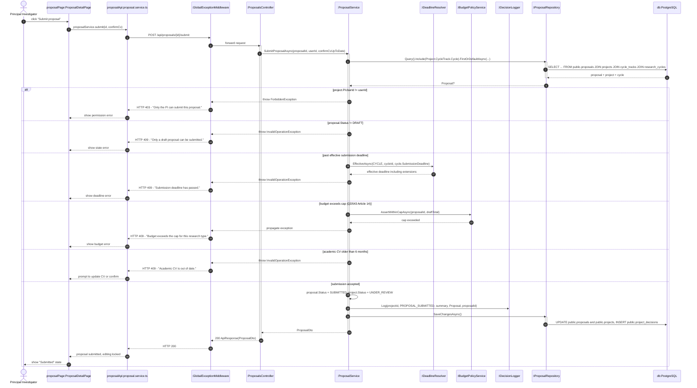

---

## 3.4 — Council Setup & Reviewer Invitation

`CouncilService` nhận 7 dependency: `IReviewRepository`, `IProposalRepository`,
`ISystemSettingService`, `INotificationRepository`, `IEmailService`, `IDecisionLogger`,
`FURPMSDbContext`.

Luồng gửi thư mời có **6 cửa chốt** trước khi gửi — trong đó quy tắc "số thành viên phải LẺ"
là ràng buộc nghiệp vụ riêng của FURPMS (để phiếu Đạt/Không đạt luôn có chênh lệch).

### Figure 10 — Class Diagram

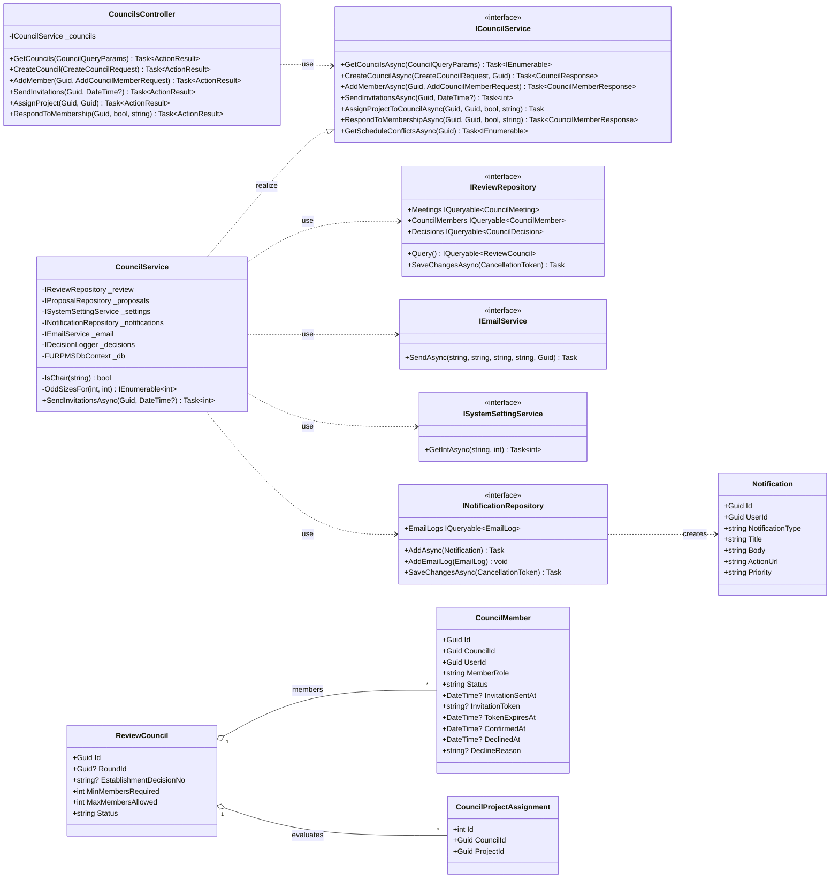

### Figure 11 — Sequence Diagram (reviewer assignment & invitation)

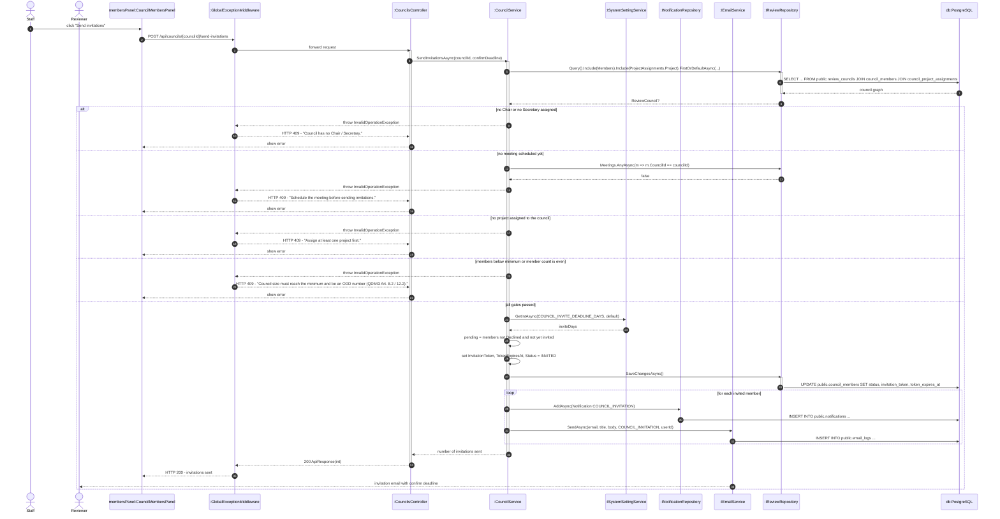

### Figure 11b — Sequence Diagram (reviewer responds to the invitation)

> **Vì sao tách khỏi Figure 11:** đây là **use case riêng** — actor khác (Reviewer, không phải Staff),
> endpoint khác (`POST /api/councils/members/{memberId}/respond`), và xảy ra **nhiều ngày sau**.
> Cẩm nang có gạch *"Gom nhiều use case vào 1 sequence → không phù hợp"*.

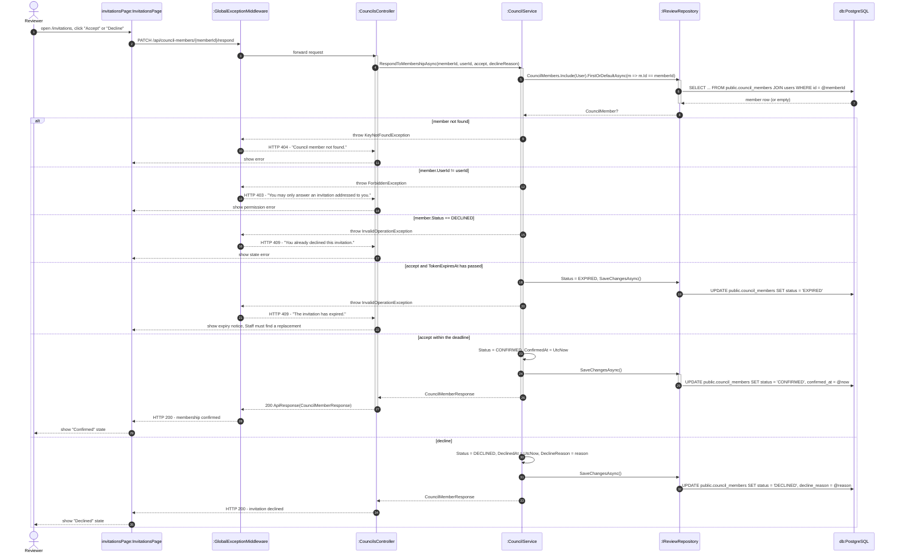

---

## 3.5 — Review Meeting Scheduling

`CouncilMeetingService` chỉ nhận **một** dependency: `IReviewRepository`. Đây là service gọn nhất
trong 7 khu vực — đừng vẽ thêm gì cho "cân hình".

### Figure 12 — Class Diagram

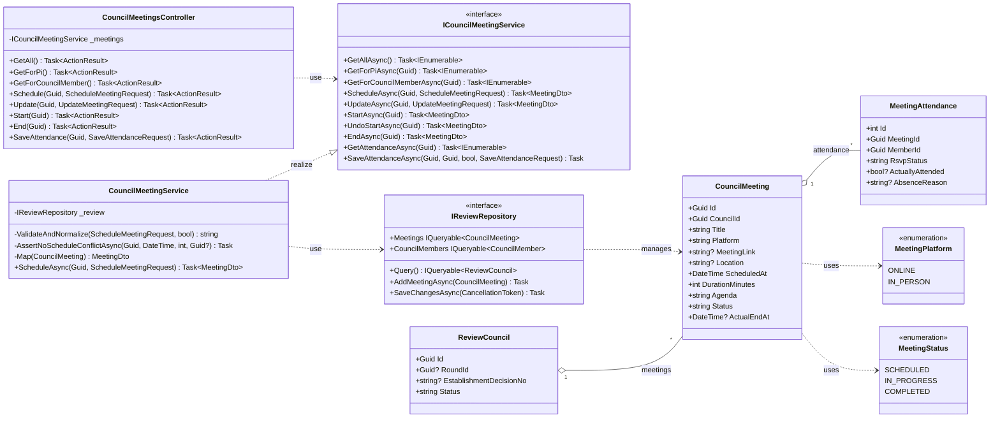

### Figure 13 — Sequence Diagram (schedule a review meeting)

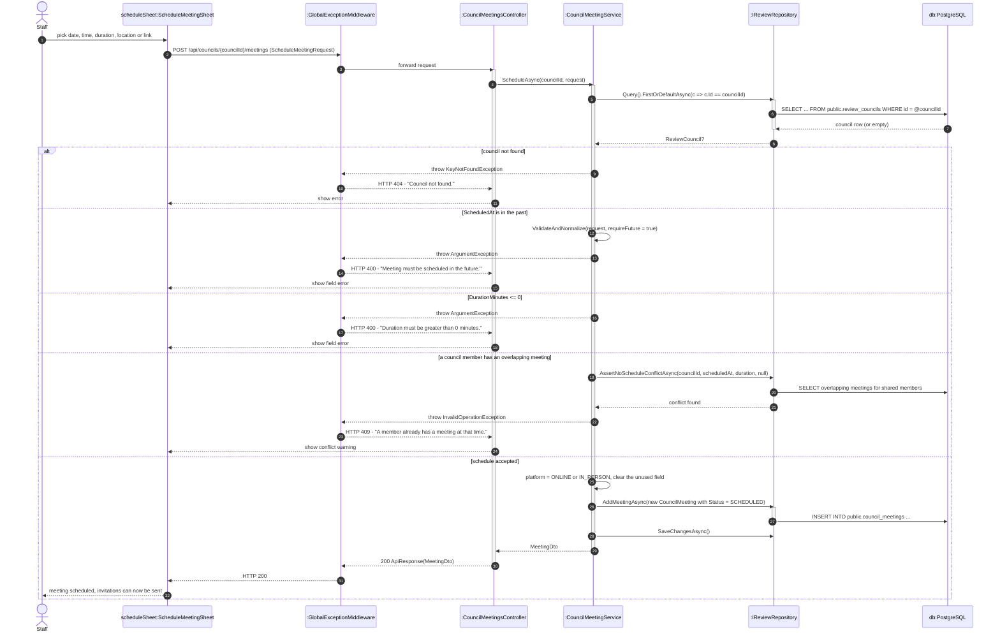

---

## 3.6 — Proposal Evaluation & Scoring

Ba vai khác nhau trong một luồng: **Uỷ viên chấm → Thư ký soạn biên bản → Chủ tịch duyệt (khoá)**.
Rule #12 của dự án: **hệ thống không tự chốt kết quả** — nó chỉ cung cấp căn cứ, `Result` luôn
chép lại kết luận của Chủ tịch.

`ReviewScoringService` nhận 7 dependency: `IReviewRepository`, `IMasterDataRepository`,
`IProposalRepository`, `IClock`, `ISystemSettingService`, `INotifier`, `IDecisionLogger`.

### Figure 14 — Class Diagram

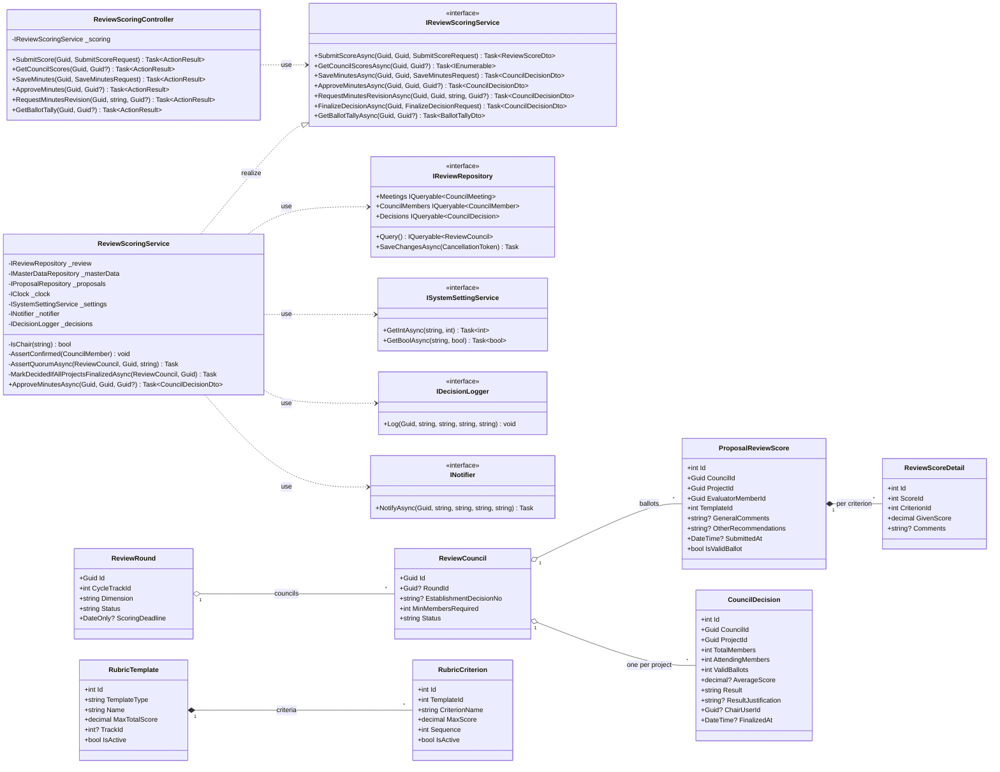

### Figure 15 — Sequence Diagram (council member submits a ballot)

> Tách khỏi phần biên bản: bản gộp cũ dài **46 message**, lệch hẳn dải 25–35 của các hình khác.

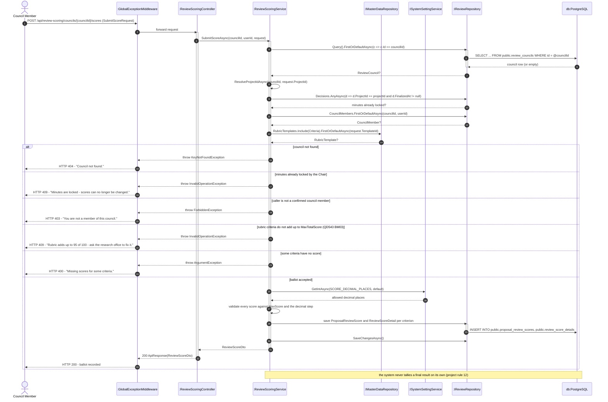

### Figure 15b — Sequence Diagram (secretary drafts the minutes, chair approves)

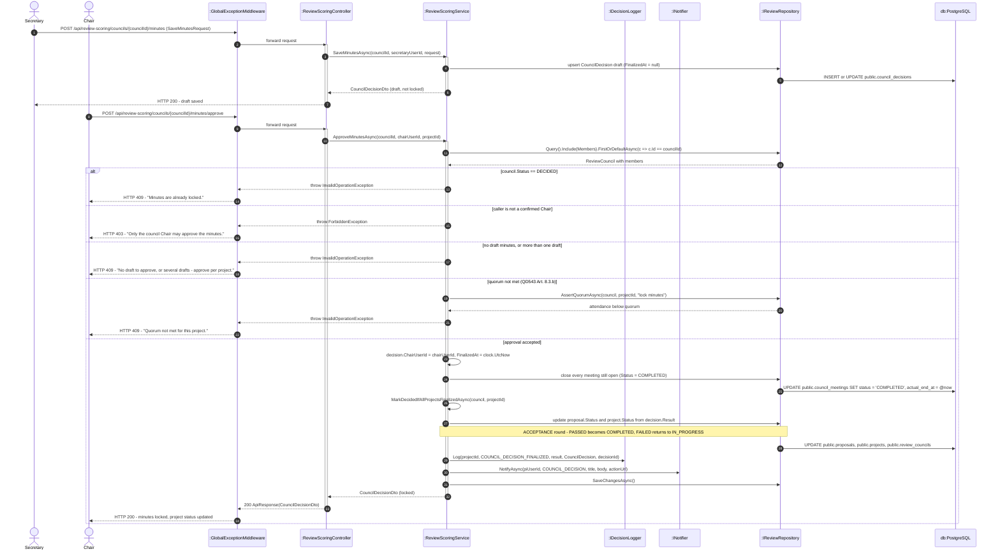

---

## 3.7 — Research Contract & Report Submission

Hai service trong cùng một mục: `ContractService` (7 dependency) và `ProgressReportService`
(6 dependency).

Cửa chốt đáng chú ý khi **ký hợp đồng**: hệ thống bắt buộc phải có **bản hợp đồng đã ký tải lên**
trước khi cho bấm ký — theo QĐ543 (BM05 Điều 7.2), hợp đồng ký điện tử ở phần mềm ngoài, hệ thống
chỉ lưu bản đã ký làm minh chứng.

### Figure 16 — Class Diagram

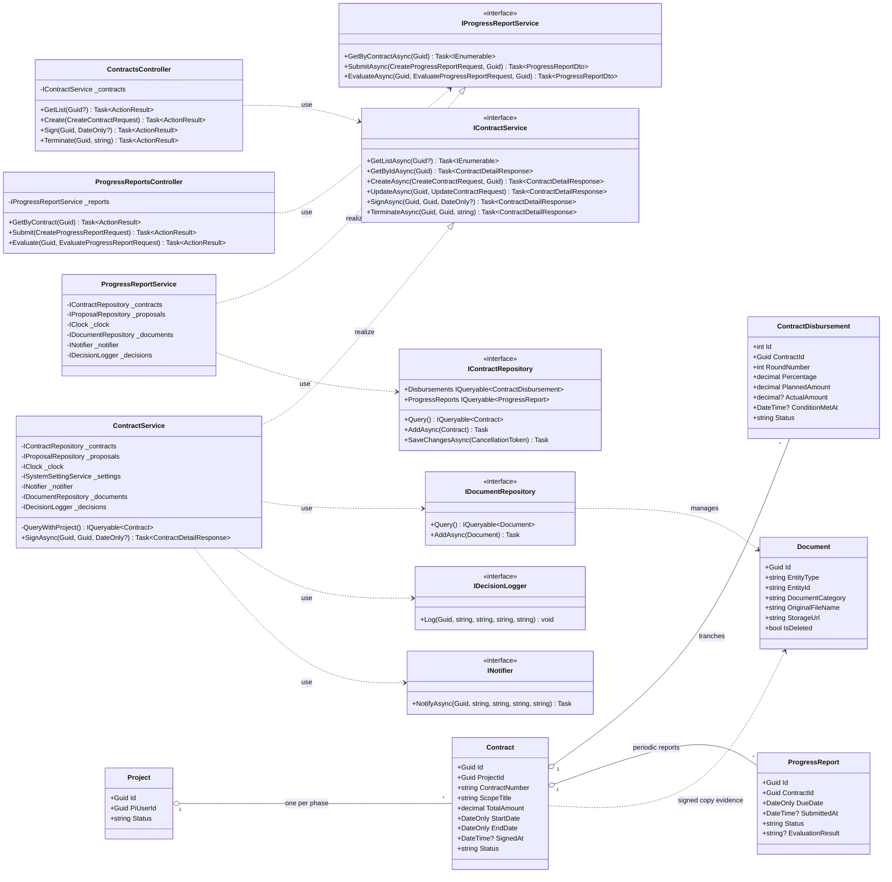

### Figure 17 — Sequence Diagram (create and sign a contract)

> Tách khỏi phần báo cáo tiến độ: đổi actor (Staff → PI) **và** cách nhau nhiều tháng.

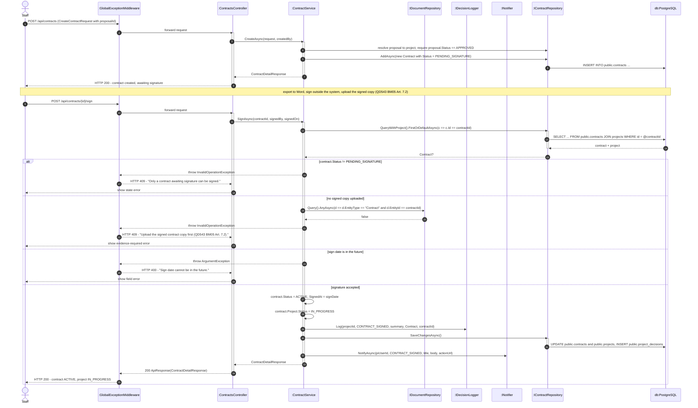

### Figure 17b — Sequence Diagram (PI submits a progress report)

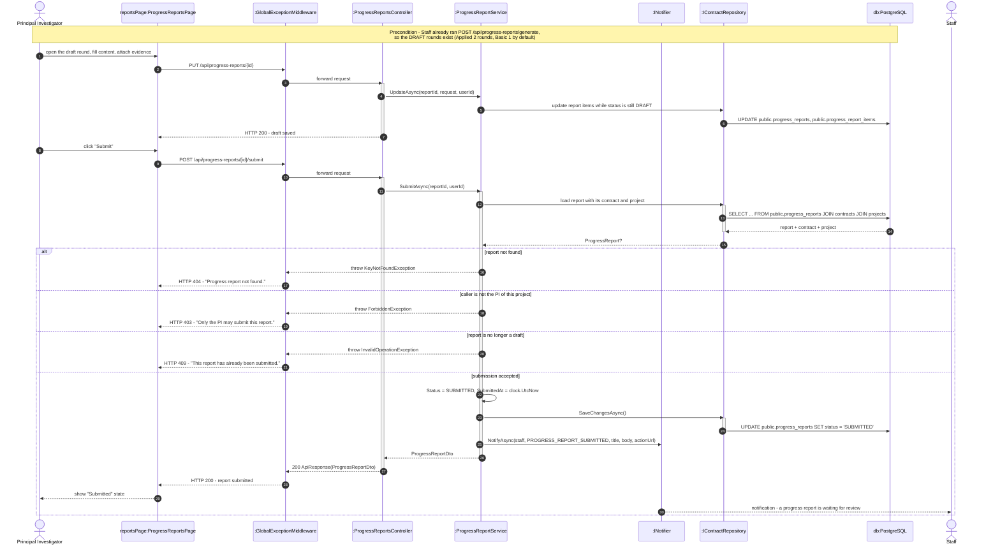
